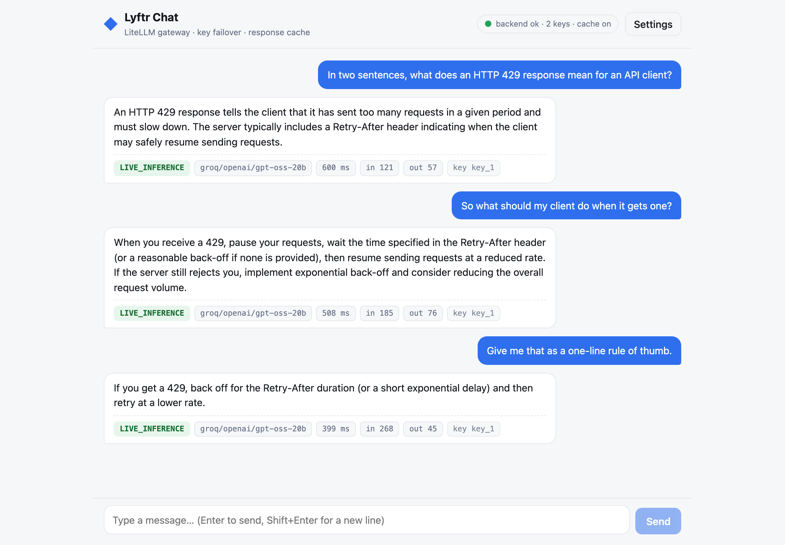
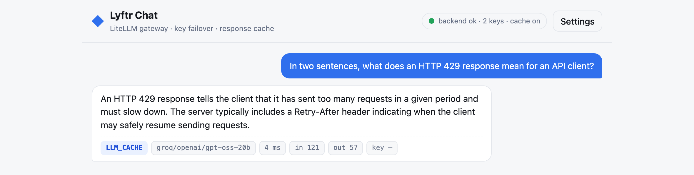
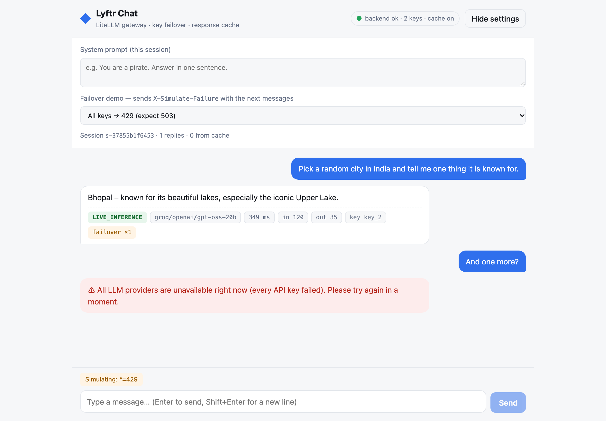
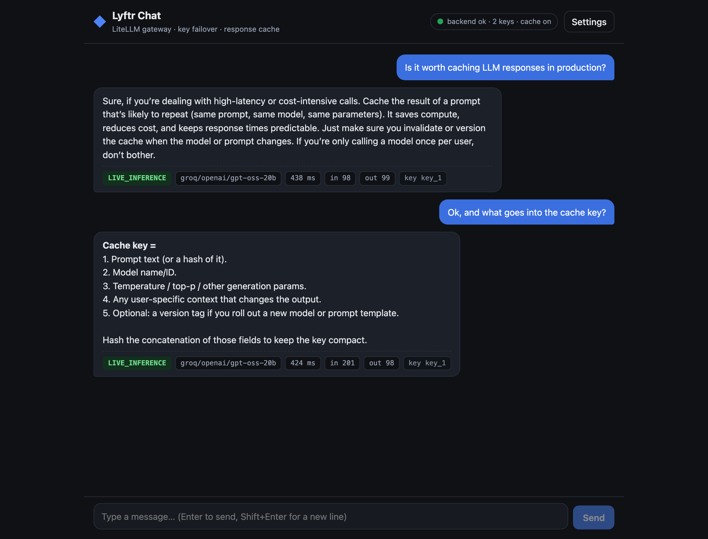

# Lyftr Chat

A small chatbot that stays up when an API key doesn't. It's built for the Lyftr AI full-stack assignment.

React talks to a FastAPI backend, and the backend uses LiteLLM to call Groq (`openai/gpt-oss-20b`). Chat history lives in SQLite. Each reply in the UI shows whether it came from the cache or a live call, which model answered, how long it took, and how many tokens that one request used.



## 1. Live URLs

- **Frontend:** _added after deploy_
- **Backend:** _added after deploy_ (`/health` is a good first click)
- **Demo video:** _added after recording_

Both run on Render's free tier. If nobody has used the backend for ~15 minutes it goes to sleep, and the first request takes 30 to 50 seconds to wake it up. After that it's fast.

## 2. Run locally

### With Docker

You need Docker and two Groq API keys. They're free at [console.groq.com/keys](https://console.groq.com/keys), and two keys from the same account work fine.

```bash
cp .env.example .env
# edit .env and set LLM_API_KEYS=gsk_first,gsk_second
make up
```

The frontend is on http://localhost:3000 and the backend on http://localhost:8000. `make down` stops the stack. The `app-data` volume holds SQLite and the cache, so your chats survive a restart. `make clean` wipes the volume too.

The Makefile uses `docker compose` if you have the v2 plugin and falls back to `docker-compose` otherwise.

### Without Docker

Backend (Python 3.11+):

```bash
cd backend
python -m venv .venv && source .venv/bin/activate
pip install -r requirements-dev.txt

export LLM_API_KEYS=gsk_first,gsk_second
export DATABASE_URL=sqlite:///./app.db
export CACHE_DIR=./.llm_cache
export ENABLE_FAILURE_SIMULATION=true
uvicorn app.main:app --reload --port 8000

python -m pytest -q   # 36 tests, no keys or network needed
```

Frontend (Node 18+):

```bash
cd frontend
npm install
VITE_API_BASE_URL=http://localhost:8000 npm run dev   # http://localhost:3000
```

### Configuration

Everything is set through environment variables. `.env.example` has all of them with placeholder values.

| Variable | Default | Notes |
|---|---|---|
| `LLM_API_KEYS` | (required) | Comma-separated. They become `key_1`, `key_2`, ... in order |
| `LLM_MODEL` | `groq/openai/gpt-oss-20b` | Any LiteLLM model string |
| `LLM_MODELS` | empty | Optional model per key, same order as the keys. Lets the pool mix providers |
| `DATABASE_URL` | `sqlite:///./app.db` | `sqlite:////data/app.db` inside Docker |
| `ALLOWED_ORIGINS` | `http://localhost:3000,http://localhost:5173` | CORS allow-list |
| `ENABLE_FAILURE_SIMULATION` | `false` | Turns on the `X-Simulate-Failure` header |
| `CACHE_TYPE` | `disk` | `disk`, `local` (in-memory) or `none` |
| `CACHE_DIR`, `CACHE_TTL_SECONDS` | `./.llm_cache`, `86400` | |
| `LLM_REASONING_EFFORT` | `low` | Only sent to reasoning models like gpt-oss |
| `LLM_TIMEOUT_SECONDS`, `LLM_MAX_OUTPUT_TOKENS`, `LLM_TEMPERATURE`, `MAX_HISTORY_MESSAGES` | `30`, `1024`, `0.2`, `40` | |
| `DEFAULT_SYSTEM_PROMPT` | short assistant prompt | Used when a session doesn't set its own |
| `API_BASE_URL` (frontend container) | `http://localhost:8000` | Written to `/config.js` when the container starts |

## 3. Design decisions

Here's how a request flows through the backend:

```
browser ──► POST /chat
             │ load session's system prompt + last 40 messages from SQLite
             ▼
           LLMGateway.complete(messages)
             │ for key in [key_1, key_2, ...]:
             │     litellm.acompletion(model, messages, api_key=key, caching=True)
             │       ├─ cache hit  → return immediately (LLM_CACHE)
             │       ├─ success    → return (LIVE_INFERENCE, key_id, fallback_attempts)
             │       └─ 429/5xx/timeout/etc → next key
             │ nothing worked → 503
             ▼
           save user + assistant message in one transaction, respond
```

### Key fallback

The keys sit in an ordered list. For each request I try `key_1` first. If the provider throws, I move to `key_2`, and so on. LiteLLM turns provider errors into typed exceptions (`RateLimitError` for 429 and quota errors, `InternalServerError`, `ServiceUnavailableError`, `Timeout`, `APIConnectionError`, and so on), so I don't have to parse Groq's error bodies myself. I also set `num_retries=0`, because retrying a key that just said "rate limited" is wasted time. Moving to the next key is the retry.

I thought about using LiteLLM's Router with `fallbacks`, and went with a short loop of my own instead. The contract wants the exact `key_id` that answered and a count of how many keys failed first. It also wants failures injected per key and per request. All of that is about 20 lines in a loop I fully control, and easy to test. With the Router I'd be digging the same information out of its internals. LiteLLM still does the parts it's good at: provider calls, error mapping and caching.

If every key fails, the response is `503 {"detail": "all providers unavailable"}` and nothing gets written to history.

**The failure hook.** With `ENABLE_FAILURE_SIMULATION=true`, a header like `X-Simulate-Failure: key_1=429` makes that key raise the same LiteLLM exception a real 429 would. So simulated failures go through exactly the same `except` branch as real ones. That was the point: I didn't want a demo-only code path that could pass while the real one is broken. The hook accepts `key_1=429,key_2=500` and `*=429`, with statuses 429/500/502/503. Unknown keys or statuses are ignored.

One judgement call: **when that header is present, I skip the cache read.** Otherwise, if you sent a message that was already cached with `key_1=429`, you'd get a cache hit with `key_id: null` and never see the failover you asked for. The fresh answer still goes into the cache.

### Caching

This uses LiteLLM's built-in cache (`litellm.cache = Cache(type="disk")`) and `caching=True` on every call. LiteLLM builds the cache key from the model, the full message list (system prompt + history + new message) and the generation params, which is exactly the rule in the brief. Some consequences:

- The same first message in a fresh session hits the cache (same system prompt + same single message).
- A different message, history or system prompt is a miss.
- The API key is **not** part of LiteLLM's cache key. I checked, because it matters: an answer generated with `key_2` during an outage can still be served later when `key_1` is back.

A cache hit is detected from `response._hidden_params["cache_hit"]`. On a hit I report `LLM_CACHE`, `key_id: null`, `fallback_attempts: 0`, and the token usage that was stored with the original response. A hit makes no network call, so it usually comes back in 2 to 5 ms, while a live Groq call takes 300 to 600 ms.



I picked disk over in-memory because the cache file sits in the same `/data` volume as the database, so it survives restarts. It's still just files on disk, no Redis.

### SQLite session storage

This is plain `sqlite3` from the standard library with WAL turned on. I didn't think an ORM was worth it for two tables. The schema is created on startup:

- `messages` follows the schema from the brief, plus an index on `(session_id, id)`.
- `sessions(id, system_prompt, created_at, updated_at)` is extra. It stores the session's system prompt, so you set it once and later turns keep using it even though the client only sends the new message.

The user message and the assistant reply are written **together in one transaction, after** the LLM call succeeds. That's what keeps failed requests (422 or 503) out of history, and a crash halfway through can't leave a question without an answer.

Only the last 40 messages are sent to the model, so long chats don't keep growing the prompt. The history endpoint still returns everything.

`latency_ms` is measured on the server, from the start of the handler until the reply is ready.

### Things I'd change with more time

- **Persistent disk on the host.** Render's free tier has no persistent disk, so the hosted SQLite file and cache reset on every redeploy. Locally the volume handles it. On a paid plan I'd attach a disk at `/data`. I'd also consider Fly.io or Railway, which both offer volumes.
- **Cooldown for keys that keep returning 429.** Right now every request tries `key_1` first. Remembering "key_1 got a 429, skip it for 30s" would save a round trip during an outage.
- **Streaming responses.** The UI waits for the full reply. Streaming would feel faster, but it complicates the cache and token accounting, so I left it out.

### Project layout

```
backend/
  app/config.py    env vars → settings, key pool
  app/db.py        SQLite schema and queries
  app/llm.py       LiteLLM gateway: cache setup, failover loop, failure hook
  app/main.py      routes, validation, error handlers, CORS
  tests/           pytest suite
  Dockerfile       multi-stage, runs as non-root, has a healthcheck
frontend/
  src/App.jsx      chat UI
  src/api.js       API client, turns error codes into readable messages
  Dockerfile       node build → nginx, backend URL injected at startup
docker-compose.yml  Makefile  .env.example  render.yaml
```

## 4. Verification

Set `B` to the backend URL (or `http://localhost:8000`).

**Health**

```bash
curl -s $B/health
# {"status":"ok","keys_configured":2,"cache_enabled":true, ...}
```

**Cache hit.** Ask the same first question in two different sessions:

```bash
curl -s -X POST $B/chat -H 'Content-Type: application/json' \
  -d '{"session_id":"demo-1","message":"What is the capital of France?"}'
# "resolution_source":"LIVE_INFERENCE","latency_ms":524,"key_id":"key_1"

curl -s -X POST $B/chat -H 'Content-Type: application/json' \
  -d '{"session_id":"demo-2","message":"What is the capital of France?"}'
# "resolution_source":"LLM_CACHE","latency_ms":3,"key_id":null, same reply, same token counts
```

**Failover**

```bash
curl -s -X POST $B/chat -H 'Content-Type: application/json' -H 'X-Simulate-Failure: key_1=429' \
  -d '{"session_id":"demo-3","message":"Name one prime number."}'
# 200, "key_id":"key_2","fallback_attempts":1

curl -s -i -X POST $B/chat -H 'Content-Type: application/json' -H 'X-Simulate-Failure: *=429' \
  -d '{"session_id":"demo-4","message":"hello"}'
# HTTP 503 {"detail":"all providers unavailable"}
curl -s $B/sessions/demo-4/messages
# {"detail":"session not found"}   (the failed request was not stored)
```

You can do the same thing from the UI. Open **Settings**, pick a failure from the dropdown, and the next messages go out with that header:



**Multi-turn and history**

```bash
curl -s -X POST $B/chat -H 'Content-Type: application/json' -d '{"session_id":"demo-5","message":"My name is Ada."}'
curl -s -X POST $B/chat -H 'Content-Type: application/json' -d '{"session_id":"demo-5","message":"What is my name?"}'
# "reply":"Your name is Ada."
curl -s $B/sessions/demo-5/messages
```

**Per-message tokens.** Each request reports only its own usage. Two first messages of the same length in two new sessions both came back as 106 input tokens. In a single conversation, input tokens grow turn by turn because the history is part of the prompt (121 → 185 → 268 in the first screenshot), but each number belongs to that request only.

**Validation**

```bash
curl -s -X POST $B/chat -H 'Content-Type: application/json' -d '{"session_id":"x","message":"   "}'   # 422
curl -s -X POST $B/chat -H 'Content-Type: application/json' -d '{oops'                              # 422
curl -s $B/sessions/nope/messages                                                                    # 404
```

**Tests.** `cd backend && python -m pytest -q` runs 36 tests. They use the real LiteLLM cache and only replace the network call (through LiteLLM's `mock_response`). They cover the response contract, cache hit/miss rules, per-request tokens, history and session isolation, every 422 case, failover on 429/500/502/503 (simulated and real exceptions), the 503 path leaving history untouched, the simulation switch, and that key values never appear in a response.

I also ran a headless Chrome pass over the UI against the Docker stack. It checks every `data-testid`, the input clearing after send, Enter to send, a new session on reload, the cache hit and failover from the dropdown, and the 503 message.

Custom system prompts work too. They're saved per session:



## 5. Setup Used

- **Editor:** VS Code
- **AI tools:** Claude Code, for scaffolding, tests and writing these docs. I reviewed the code, ran everything against the assignment checklist and tested it with real keys.
- **Runtime:** Python 3.12, FastAPI, LiteLLM, Node 20, React 18 + Vite, Docker (Colima on macOS)

## 6. Bonus features

- **Failover dropdown in the UI.** It sends `X-Simulate-Failure` from the browser, so failover and the 503 message can be shown on the live site without curl.
- **Disk cache in the data volume.** Cache hits still work after a restart.
- **Per-key models (`LLM_MODELS`).** The pool can mix providers, e.g. a Groq key and a Gemini key, so one provider having a bad day doesn't take the app down.
- **System prompt per session**, stored in SQLite.
- **Health badge** in the header: backend status, number of keys, cache on/off.
- **Light formatting for replies.** Bold, inline code and code blocks render properly, built as React elements rather than injected HTML, so model output can't inject markup.
- **Dark mode**, following the OS setting.
- **One frontend image for any backend.** The nginx container writes the backend URL into `/config.js` when it starts, so there's no rebuild per environment.
- **Small hardening:** the backend runs as a non-root user, there's a Docker healthcheck, keys are hidden from logs and `repr`, and each exchange is saved in a single transaction.
